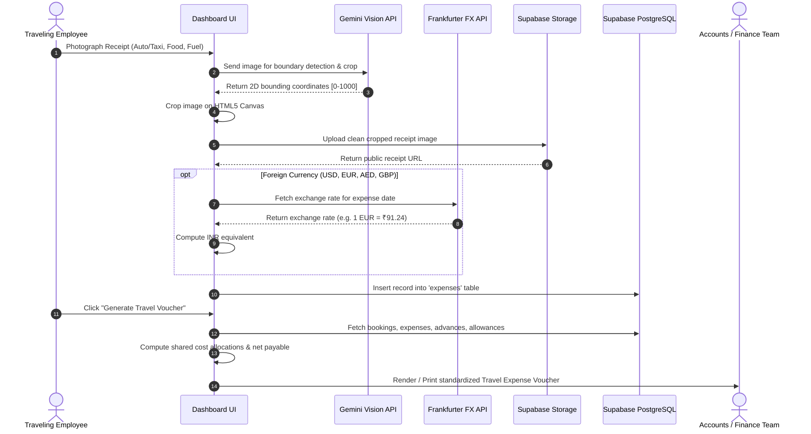

# 05. Corporate Spend & Travel Voucher Engine

One of the core capabilities of the **Travel Tracker Dashboard** is its end-to-end corporate spend management and automated voucher settlement engine. It replaces paper-based expense claims with audit-ready digital vouchers matching company accounting rules.

---

## 1. The Corporate Spend Lifecycle



---

## 2. Expense Logging & Categorization

### 2.1 Standard Expense Categories
All trip expenditures are classified into five standard categories:
1. **Food**: Meals, client dinners, refreshments.
2. **Transport (Auto/Taxi)**: Local autos, Uber/Ola rides, city transit.
3. **Petrol/Diesel**: Fuel purchases for corporate or personal vehicles.
4. **Toll**: Highway toll plaza payments (Fastag / cash).
5. **Misc. Expenses**: Printing, parking, SIM cards, entry passes.

### 2.2 Payment Methods & Account Tracking
Expenses can be logged under three payment methods:
- `Cash`: Requires selecting the source company bank account (`Cosmos`, `Bank of Maharashtra`, or `ICICI`), stored in `cardused` for banking reconciliation.
- `GPay`: Unified Payments Interface (UPI) transactions.
- `Card`: Company corporate cards. Because card charges are settled directly by the company, they are deducted during reimbursement reconciliation.

### 2.3 Multi-Receipt Ingestion & Quick Review Modal (`SingleReceiptReviewModal.tsx`, `BatchUploadModal.tsx`)
- **Multi-Receipt Photo Support**: Employees can lay out multiple payment slips (fuel bills, parking tokens, toll receipts) side-by-side in one photo. The vision engine detects individual slips, computes their mathematical sum, and writes an itemized breakdown into the description.
- **Inline Payment Method & Corporate Card Selector**:
  - The confirmation modal ([`SingleReceiptReviewModal.tsx`](file:///home/embedded4/travel-tracker-dashboard/src/components/dashboard/SingleReceiptReviewModal.tsx)) features immediate `Cash | Card | GPay` toggling.
  - Automatically matches card digits from slips (e.g. `2001`) to the company corporate card roster (`XXXX XXXX XXXX 2001`).
  - Travelers can verify amount, trip, category, and corporate card in a single screen before committing.
- **Pre-Upload Compression**: Compresses photos from 3–10MB down to ~250KB JPEG via HTML5 Canvas before uploading to Supabase Storage, preventing network bottlenecks during batch uploads.

---

## 3. Automated Foreign Exchange (FX) Conversion

For international business trips (e.g., Dubai, Europe, Singapore, USA), expenses are frequently incurred in foreign currencies.

### 3.1 Frankfurter FX Integration (`src/lib/dashboard-api.ts`)
The dashboard integrates directly with the **Frankfurter Currency API** (`api.frankfurter.dev`), backed by the European Central Bank:

```typescript
export async function fetchFxRate(
  isoDate: string,
  fromCurrency: string,
): Promise<{ rate: number; dateUsed: string } | null> {
  if (!isoDate || !fromCurrency || fromCurrency.trim().toUpperCase() === "INR") return null;
  try {
    const url = `https://api.frankfurter.dev/v2/rates?date=${isoDate}&base=${fromCurrency.trim().toUpperCase()}&quotes=INR`;
    const res = await fetch(url);
    if (!res.ok) return null;
    const json = await res.json();
    // Resolves historical ECB conversion rate for the exact date of purchase
    let rate = Array.isArray(json) ? json[0].rate : json?.rates?.INR;
    return { rate, dateUsed: json?.date || isoDate };
  } catch {
    return null;
  }
}
```

### 3.2 Automated Invoicing
When an employee inputs `€ 45.00` with date `2026-05-14`, the dashboard fetches the historical rate for that date (e.g. `91.24`), calculates `₹ 4,105.80`, and stores both the original currency and INR equivalent in PostgreSQL.

---

## 4. Advances & Daily Allowances

Accurate trip reconciliation requires tracking pre-trip disbursements:

1. **Travel Advances (`advances` table)**:
   - Cash or bank transfers given to an employee prior to trip departure to cover operational expenses.
   - Example: ₹25,000 cash advance issued by Accounts.
2. **Daily Allowances (`allowances` table)**:
   - Per diem travel allowance earned by employees for every full or partial day of outstation travel.
   - Example: ₹1,500/day $\times$ 4 days = ₹6,000 daily allowance.

---

## 5. The Corporate Travel Voucher Generator (`TravelVoucherView.tsx`)

The **Travel Voucher** is the official financial reconciliation document used by company management and accounts.

### 5.1 Shared Booking Cost Allocation Algorithm (`src/lib/expense-utils.ts`)
When two or more employees travel together on a single flight or share a hotel room, booking costs must be fairly divided:

```typescript
export function sumBookingInr(
  records: Record<string, string>[],
  amountField: string,
  trip: string,
  username: string,
  name: string,
): number {
  let total = 0;
  for (const r of records) {
    if ((r.trip || GENERAL_TRAVEL).trim() !== trip) continue;
    if (!isAssignedToTrip(r, username, name)) continue;
    if ((r.bookingstatus || "").trim().toLowerCase() === "cancelled") continue;
    
    const raw = r[amountField] || "";
    if (!raw) continue;

    // Detect passenger sharing
    const assignees = splitPassengerList(r.assignedto);
    const assigneeCount = Math.max(assignees.length, 1);
    const isPerPerson = (r.amounttype || "total").trim().toLowerCase() === "perperson";
    
    // If "total": each person's share = amount / assigneeCount.
    // If "perperson": amount is already individual.
    const shareDivisor = isPerPerson ? 1 : assigneeCount;
    const n = parseAmount(r.inrequivalent || raw);
    
    if (!Number.isNaN(n)) total += n / shareDivisor;
  }
  return total;
}
```

### 5.2 Multi-Participant Aggregated Vouchers
In addition to individual employee vouchers, management can generate a **Combined Trip Voucher** representing the total corporate cost of a multi-employee group trip using multi-participant summation functions (`sumBookingInrMulti`, `sumExpensesByCategoryMulti`, `sumAdvancesMulti`, `sumAllowancesMulti`).

### 5.3 Voucher Accounting Matrix
The voucher calculates:
```
  [ TOTAL EXPENDITURES ]
  (+) Air Tickets
  (+) Lodging (Hotels)
  (+) Transport (Bus / Train)
  (+) Transport (Auto / Taxi)
  (+) Food
  (+) Petrol / Diesel
  (+) Toll
  (+) Daily Allowance
  (+) Misc. Expenses
  ───────────────────────────────────────
  (=) GRAND TOTAL EXPENSES (A)

  [ SETTLEMENT RECONCILIATION ]
  Grand Total Expenses (A)
  (-) Less: Paid Directly via Corporate Card
  (-) Less: Advance Disbursed by Company
  ───────────────────────────────────────
  (=) NET BALANCE REIMBURSABLE / REFUNDABLE
```

If Net Balance is positive, the company reimburses the employee. If negative (excess advance remaining), the employee refunds the remaining company cash.

### 5.4 Card Spend Breakdown on Vouchers
Under **"Total Credit Card Exp. :"**, the voucher lists expenses grouped by company card:
- Displays each active card by its last 4 digits (e.g. `1) Card ending in 6002`) along with its total spend.
- Cards with zero expenses are omitted, and unused rows remain as blank dotted lines.
- Card labels and amounts remain editable on screen for manual adjustments prior to printing.

### 5.5 Company Card Management (`SettingsModal.tsx`)
Administrators (`Owner`, `System Manager`, `HR`, `Accounts`) can manage company credit cards under Settings:
- Stored in the `config` table (`company_cards`).
- Cards can be added (entering the last 4 digits or a full label) or removed.
- Updates reflect automatically in the card selector on expense forms.


### 5.6 Print-Ready Corporate Styling (`@media print`)
The voucher dialog incorporates custom print CSS rules:
- Suppresses top navigation bars, sidebar buttons, and background colors.
- Renders high-contrast black-and-white tabular borders conforming to the physical company voucher format.
- Prepares signature lines for:
  - *Employee Signature*
  - *Checked By (HR / Accounts)*
  - *Sanctioning Authority (Director / Managing Director)*

### 5.7 Trip Financial Management & Owner/Staff Split Vouchers (`TripExpensesPanel.tsx`)
The **Trip Expenses Panel** provides a dedicated financial command center for managing the monetary lifecycle of any specific corporate trip:
- **Owner vs. Staff Voucher Separation**:
  - In corporate governance, the Managing Director / Owner's travel expenditures often undergo a different auditing and sanctioning pathway than general staff claims.
  - The engine inspects participant roles and canonical identifiers (`OWNER_USERNAME = "rajesh k"`).
  - Offers one-click targeted voucher generation:
    - **Combined Staff Voucher**: Automatically filters and aggregates all non-owner participants into a unified team claim.
    - **Owner Voucher**: Generates an isolated settlement voucher strictly containing the owner's booking shares, personal card expenditures, and allowances.
- **Date-Range Scoped Settlements**:
  - Allows finance teams to specify custom start and end date boundaries (`startDate`, `endDate`).
  - Enables generating interim vouchers for mid-trip month-end payroll closes or multi-phase exhibitions.
- **In-Panel Advances & Allowances Administration**:
  - Manage cash advances disbursed to specific employees directly within the trip context.
  - Set and adjust per-diem daily allowance calculations based on actual trip length.
- **Trip Settlement Status Toggle**:
  - Allows marking a trip as "Completed", locking in historical totals and signaling Accounts that all employee claims are finalized.

---

## 6. Consolidated Receipts Auditor & Print Engine (`ConsolidatedReceiptsView.tsx`)

The **Consolidated Receipts View** serves as an auditing gallery and tax-compliance print engine for corporate accounting review:
- Collects every receipt image attached to a specific trip.
- Shows side-by-side expense metadata: Date, Category, Amount in INR, Payment Method, Card Used, Description.
- Features interactive zoom and pan controls for auditing small or faint receipt text.
- Provides batch download controls to export all trip receipts as a consolidated package for tax filing.

### 6.1 Resilient Google Drive Media Pipeline
Historical company expense receipts hosted on Google Drive frequently fail to render due to Google's anti-hotlinking protections and broken `/preview` iframes. The platform implements a **4-tier candidate fallback pipeline**:
1. `https://drive.google.com/uc?export=view&id=${id}` (Direct export endpoint)
2. `https://lh3.googleusercontent.com/d/${id}` (High-speed Google UserContent CDN)
3. `https://drive.google.com/thumbnail?id=${id}&sz=w1000` (High-resolution thumbnail)
4. `https://drive.usercontent.google.com/download?id=${id}&export=view`
- **Referrer-Policy**: Images are tagged with `referrerPolicy="no-referrer"` to bypass cross-origin header rejections.
- **Eager Loading**: Images use `loading="eager"` to guarantee immediate rasterization during browser print rendering and PDF export.

### 6.2 Ultra-Compact Print Layouts (`3×3` & `4×3`)
Standard print formats often waste paper by placing single receipts per page inside thick borders:
- **Zero Bounding-Box Waste**: Strips padding, heavy bounding frames, and unnecessary text labels in print mode (`@media print`).
- **Interactive Print Density Switcher**:
  - **3×3 Layout**: Packs 9 to 12 receipt cards per A4 page (`print:grid-cols-3`).
  - **4×3 Dense Layout**: Packs 12 to 16 receipts per A4 page (`print:grid-cols-4`).
- **Toggleable Print Metadata**: An on-screen checkbox allows Accounts auditors to toggle receipt text descriptions on or off, maximizing receipt image area on physical printouts.

---

## 7. Executive Corporate Spend Analytics & Visualizations (`SpendView.tsx`)

To give directors and department heads immediate visibility into organizational travel burn rates, the platform provides an executive analytics dashboard:
- **Interactive Recharts Visualizations**:
  - **Monthly Spend Trend**: A responsive bar chart (`BarChart`) aggregating expenditures by month, color-coded by transit modality and expense type.
  - **Modality & Category Distribution**: A donut pie chart (`PieChart`) displaying proportional spending across Flights, Hotels, Trains, Buses, and on-ground categories (Food, Auto/Taxi, Fuel, Toll, Misc).
- **Indian Numbering System Formatting (`formatInrAbbrev`)**:
  - Automatically abbreviates large multi-trip corporate totals into intuitive Indian numbering representations:
    - Values $\ge$ ₹1 Crore are formatted as `₹ X.XX Cr` (e.g. `₹ 1.25 Cr`).
    - Values $\ge$ ₹1 Lakh are formatted as `₹ X.XX L` (e.g. `₹ 4.80 L`).
    - Values $\ge$ ₹1 Thousand are formatted as `₹ X.XX k` (e.g. `₹ 45.50 k`).
- **Unresolved Foreign Currency Warnings**:
  - Flags international transactions where automated ECB FX rates could not be resolved (e.g., historical dates outside bank trading days or missing quotes).
  - Displays prominent visual warning pills (`AlertTriangle`) indicating unresolved amounts that require manual currency verification before voucher finalization.

---

## 8. Booking Spend Financial Editor & Live FX Recalculation (`SpendEditDialog.tsx`)

Accounts auditors frequently need to adjust booking amounts, amend currencies, or adjust passenger cost-sharing rules after receiving vendor invoices:
- **Direct Financial Modal Editor**: Allows editing base ticket fare, hotel room rates, currency codes, and applied exchange rates without altering passenger itineraries.
- **Passenger Cost Allocation Switcher**:
  - **Total**: The specified amount is the grand total for the booking, divided equally among all assigned passengers.
  - **PerPerson**: The amount represents an individual passenger charge, multiplied by the number of travelers when computing group trip totals.
- **Live On-Demand Frankfurter FX Query**:
  - Includes a direct "Fetch Live Rate" trigger within the modal.
  - Queries `api.frankfurter.dev` for the exact transaction date, automatically updating the INR conversion field and showing the effective date used.
